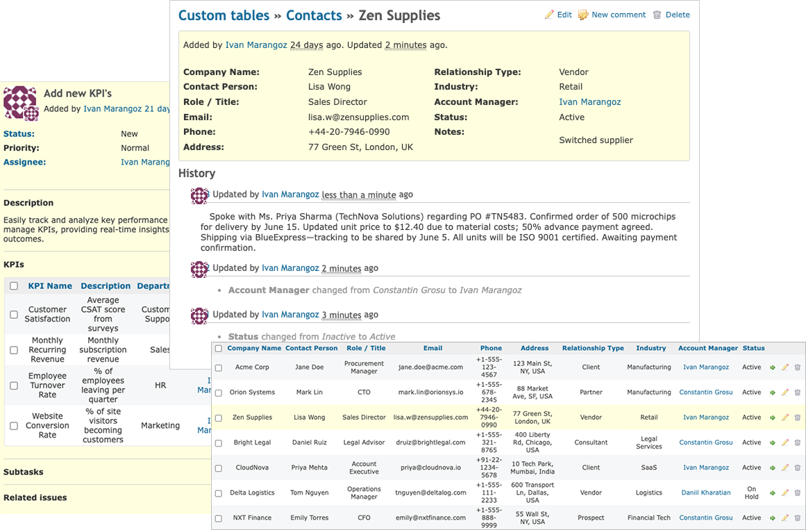
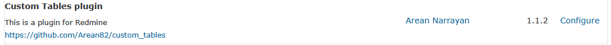
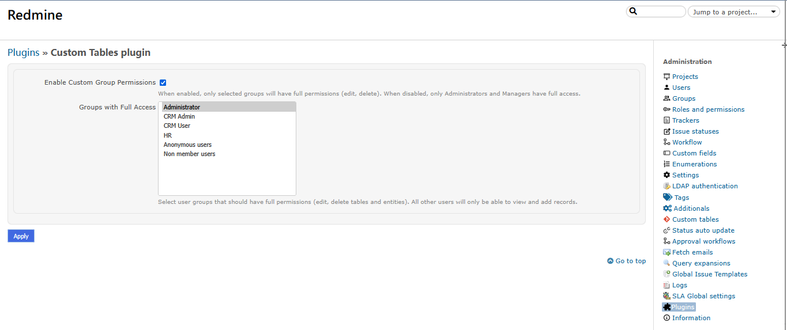

# Redmine Custom Tables v2

[](https://www.redmine.org)
[](https://www.ruby-lang.org)
[](https://opensource.org/licenses/MIT)

**Author:** Arean Narrayan ([@Arean82](https://github.com/Arean82))  
**Repository:** [https://github.com/Arean82/custom_tables](https://github.com/Arean82/custom_tables)  
**Original Fork:** [frywer/custom_tables](https://github.com/frywer/custom_tables)

Custom Tables v2 is a comprehensive plugin for Redmine that empowers administrators and teams to construct flexible, relational database tables directly inside Redmine using standard custom fields. Seamlessly integrate structured tracking tables into issues, projects, and administrative workflows with enterprise-grade permission management.

---



---

## 🚀 Key Features in Version 2.0.0

* **Full Redmine 7.x & Rails 7 Compatibility:** Completely refactored and certified for Rails 7 and Zeitwerk autoloading with clean `to_prepare` architecture.
* **Granular Group & Role Permission System:** Control which user groups and roles can view, create, edit, bulk-update, or delete table records.
* **Multi-Layer Security:** Action-level controller guards paired with view-level conditional UI rendering so destructive controls are cleanly hidden from unauthorized users.
* **Interactive Table Constructor:** Build columns utilizing Redmine's full suite of custom field formats (String, Text, Float, Integer, Date, List, User, Belong-to relations, etc.).
* **Issue & Project Embedding:** Automatically link and display relevant custom tables inside issue detail views.
* **Exporting & Reporting:** Native export capabilities to CSV and PDF.
* **REST API:** Fully operational JSON/XML API for external services, automation scripts, and integrations.

---

## ⚙️ Configuration & Screenshots

Configure group-based access control directly from the settings interface:



Fine-tune role and group permissions per table:



---

## 📋 Compatibility

* **Redmine:** 5.0.x, 5.1.x, 6.0.x, and **Redmine 7.0.x**
* **Ruby:** 3.0, 3.1, 3.2, 3.3, 4.0
* **Rails:** 6.1, 7.0, 7.1+ (Zeitwerk mode)
* Tested in production environments on Redmine 7.0.3

---

## 🛠️ Installation Instructions

> **Note:** Always run `bundle` and `rake` commands from the **Redmine root directory**, never from inside the plugin directory.

### 1. Clone the repository
Navigate to your Redmine `plugins` folder and clone the repository:

```bash
cd /data/redmine/plugins
git clone https://github.com/Arean82/custom_tables.git
```

### 2. Configure Bundler & Dependencies
From your Redmine root directory:

```bash
cd /data/redmine
bundle config set --local without 'development test'
bundle install
```

### 3. Run Database Migrations
Run the plugin database migrations from the Redmine root directory:

```bash
bundle exec rake redmine:plugins:migrate RAILS_ENV=production
```

### 4. Restart Redmine
Restart your Redmine application server (e.g., Puma, Passenger, or systemd):

```bash
sudo systemctl restart redmine
```

---

## 📖 Quick Start & Usage

1. **Create a Custom Table:**
   * Go to **Administration** → **Custom tables**.
   * Click **New table**, enter a title, and select which projects and trackers should include this table.
2. **Define Columns:**
   * Click into your new table and add the desired custom fields (text, date, number, users, dropdowns, etc.).
3. **Configure Permissions:**
   * Go to **Administration** → **Plugins** → **Custom Tables plugin v2** → **Configure**.
   * Toggle **"Enable Custom Group Permissions"** to specify which groups are allowed to edit or delete records.
4. **Assign Roles:**
   * Go to **Administration** → **Roles and permissions** to grant the `Manage custom tables` and `View custom tables` permissions to your roles.

---

## 📄 License

This plugin is licensed under the [MIT License](LICENSE).
